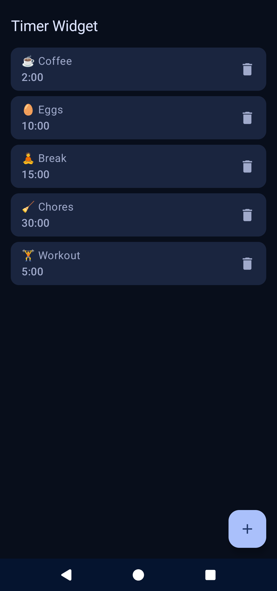
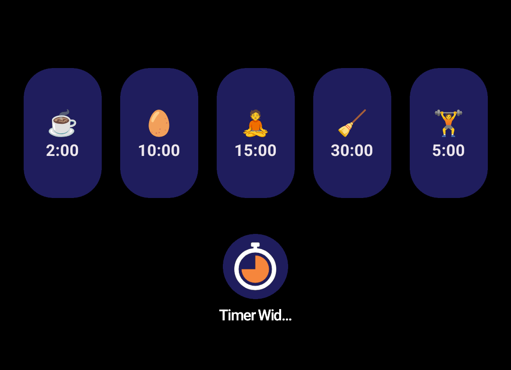
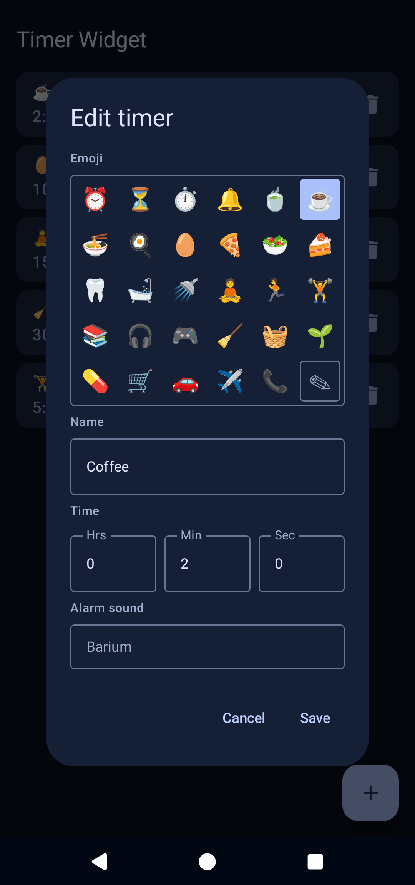

# Timer Widget

Preset home-screen timer widgets: one tap to start

Start a preset countdown in one tap, straight from your home screen.

Define named timers in the app - each with a name, optional emoji, and
duration - then place one or more 1x1 widgets on your home screen, one
per timer. Tap a widget to start its countdown; tap again to cancel.

If you regularly time the same things - brewing tea, a parking meter,
laundry, a short break - this is the fastest way to start that
countdown: set the duration once, then one tap every time after that.

Timers are stored locally on the device. No network access, no ads, no
analytics, no trackers.

Features:

- Multiple timers, each with a name, emoji, and duration
- One 1x1 home-screen widget per timer; tap to start, tap again to cancel
- No app to open: timers start and cancel from the widget itself
- Per-timer alarm sound picker

## Screenshots

<p>



</p>

## Requirements

- Android 8.0 (API 26) or newer
- JDK 21
- Android SDK (platform 37, build-tools, platform-tools)

## Building

```bash
./gradlew assembleDebug        # debug APK
./gradlew testDebugUnitTest    # JVM + Robolectric tests
./gradlew assembleRelease      # release APK (minified, resource-shrunk)
```

Install the debug APK on a connected device/emulator with
`adb install -r app/build/outputs/apk/debug/app-debug.apk`.

## Testing

Unit tests (JUnit + Robolectric) cover the data model, ViewModel logic, and
time formatting: `./gradlew testDebugUnitTest` (same command as above).

## Screens

| Screen | Purpose |
|---|---|
| Main app | Create, edit, and delete timers (name, emoji, duration) |
| Widget config | Shown when placing a widget: pick which timer it controls; reconfigurable later |
| Widget | Shows the timer's emoji/name and remaining time; tapping toggles start/cancel |

## Making a release

Releases are manual but reproducibly signed: F-Droid rebuilds from the tag
and, because the build is byte-for-byte deterministic and the signature
files are published, ships the APK with our own signing key. `versionName`
must match the tag, and `versionCode` must strictly increase, or F-Droid
(and Play) will reject the build.

The full runbook - bump, tag, build with fdroidserver, sign, upload,
extract signatures, and the fdroiddata update MR - is in
[RELEASES.md](RELEASES.md). The short version:

1. Bump `versionName`/`versionCode` and add the fastlane changelog for the
   new `versionCode`.
2. Commit, then tag with an annotated tag matching `versionName`:

   ```bash
   git tag -a v<versionName> -m "Timer Widget <versionName>"
   ```

3. Build the reference APK with `fdroid build`, sign it with the release
   keystore, and attach it to the GitHub release.
4. Extract the APK signature files into fdroiddata's
   `signatures/<versionCode>/` and add them to the update MR (the
   checkupdates bot files the yml part automatically).

## How it works

- **App UI** (`MainActivity` + `App.kt`): Jetpack Compose list of timers backed
  by `TimerViewModel`, which keeps UI state in memory and persists to DataStore
  in the background so text input never lags.
- **Storage**: `TimerStore` serializes the timer list as JSON into a DataStore
  Preferences file; `WidgetPrefs` maps each widget instance to a timer ID in
  plain SharedPreferences.
- **Widget** (`TimerWidget`): the `AppWidgetProvider` renders the initial view
  from `TimerWidgetViews`; each tap sends a toggle `PendingIntent` to
  `TimerService`.
- **Service** (`TimerService`): a special-use foreground service holds all
  running timers in memory, ticks once per second, pushes updated `RemoteViews`
  to each widget, and posts an alarm notification on completion.

## Project layout

```
app/src/main/java/io/github/conorryan/timerwidget/
├── App.kt                  # Compose timer list + add/edit dialog
├── MainActivity.kt         # Launcher activity, notification permission
├── data/Timers.kt          # TimerDef model + DataStore-backed TimerStore
├── ui/                     # Theme + TimerViewModel
├── util/Format.kt          # formatHms helper
└── widget/                 # AppWidgetProvider, config activity, service, prefs
```

## License

MIT - see [LICENSE](LICENSE). Third-party notices are in
[THIRD_PARTY_NOTICES.md](THIRD_PARTY_NOTICES.md).
